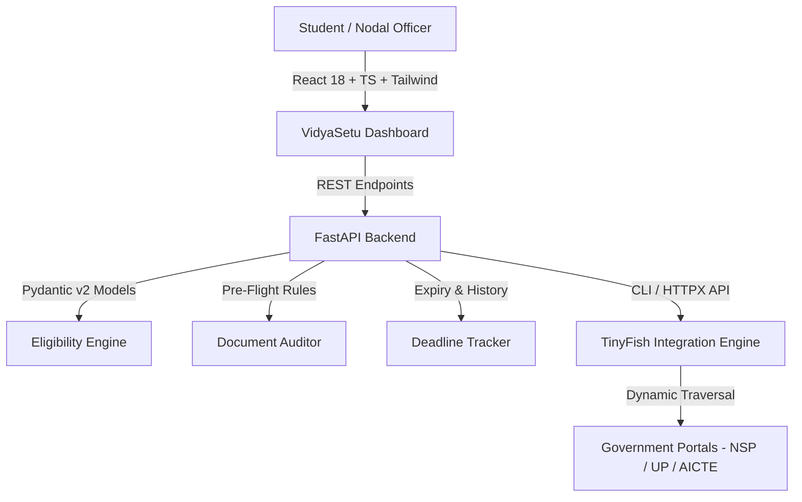

# VidyaSetu — Welfare Intelligence
> **Autonomous Scholarship, Grant & Higher-Education Entitlement Engine**  
> **HackIIITD 2026** | **Team TwoBit** | **KIET Group of Institutions, Ghaziabad (Delhi-NCR)**  
> **Project Lead:** Shubham Kumar
> **Contributor:** Rashi Sharma
> **Repository:** [https://github.com/shubham34970/VidyaSetu.git](https://github.com/shubham34970/VidyaSetu.git)  
> **Powered by:** TinyFish API (Dynamic Web Navigation & Extraction)

---

## 🎯 The Problem: India's ₹4,200+ Crore Welfare Loss
Every academic year, over **₹4,200+ Crores** in central and state higher-education scholarships and fee reimbursements lapse or go unclaimed. Deserving students face systemic hurdles:
1. **Fragmented Portals:** More than 30+ disparate portals (National Scholarship Portal, UP Scholarship, MahaDBT, AICTE) with inconsistent structures, dead links, and shifting PDF notices.
2. **The 84% Technical Rejection Trap:** Over 84% of disqualified applications stem from minor procedural defects: expired income certificates, incorrect domicile formats, or missed 72-hour rectification windows.
3. **Information Asymmetry:** Students discover schemes after official deadlines have closed or fail to navigate complex eligibility matrices.

---

## 💡 The Solution: VidyaSetu
**VidyaSetu** is an autonomous civic-tech intelligence platform providing:
- **Autonomous Portal Scraping:** Real-time web navigation and circular PDF extraction powered by **TinyFish API**.
- **Deterministic Rule Normalization:** Structured Pydantic schemas standardizing benefits, eligibility, and deadlines.
- **Explainable Eligibility Matching:** Transparent matching with explicit conditions, disqualification reasons, and official citations.
- **Pre-Flight Document Compliance Auditor:** Heuristic checks verifying document validity, issuing authority, and academic year alignment before portal submission.
- **Verified Deadline Tracker:** Time-series tracking of circular extensions and urgent application windows.

---

## 🏛️ Initial Priority Schemes
1. **Uttar Pradesh Post-Matric & Inter-State Scholarship** (`scholarship.up.gov.in`)
2. **National Scholarship Portal (NSP) Central Sector Schemes** (`scholarships.gov.in`)
3. **AICTE Pragati Scholarship for Girls** (`aicte-india.org` / `scholarships.gov.in`)

---

## 🏗️ System Architecture


---

## 🚀 Quick Start Guide (Windows)

### Prerequisites
- **Python:** 3.10+ (Verified on Python 3.13.2)
- **Node.js:** v18+ (Verified on Node v24.22.1 / npm 11.7.0)
- **TinyFish CLI:** v0.52.1+ (Optional for live web extraction; system falls back gracefully to verified cached schemes)

---

### Step 1: Environment Setup

#### In Windows PowerShell:
```powershell
# Clone the repository (if not already cloned)
git clone https://github.com/shubham34970/VidyaSetu.git
cd VidyaSetu

# Copy environment template
Copy-Item .env.example .env
```

#### In Windows Command Prompt (CMD):
```cmd
cd VidyaSetu
copy .env.example .env
```

Configure `TINYFISH_API_KEY` in `.env` if you have an active key. If omitted, VidyaSetu will seamlessly operate in cached/demo demonstration mode.

---

### Step 2: Backend Startup (FastAPI)

#### Windows PowerShell / CMD:
```powershell
# Install backend requirements
pip install -r backend/requirements.txt

# Start FastAPI server
uvicorn backend.main:app --host 127.0.0.1 --port 8000 --reload
```
The backend API documentation will be available at:  
- **Interactive Swagger UI:** [http://127.0.0.1:8000/docs](http://127.0.0.1:8000/docs)  
- **Health Check Endpoint:** [http://127.0.0.1:8000/api/health](http://127.0.0.1:8000/api/health)

---

### Step 3: Frontend Startup (React + Vite + Tailwind)

#### In a separate terminal:
```powershell
cd frontend
npm install
npm run dev
```
The VidyaSetu dashboard will launch at: [http://localhost:5173](http://localhost:5173)

---

## 🧪 Testing & Verification

### Run Backend Pytest Suite:
```powershell
python -m pytest tests/ -v
```

### Run Frontend Production Build Check:
```powershell
cd frontend
npm run build
```

---

---

## 📑 Round 1 Mentor & Evaluator Documentation
- **Mentor & Judge Evaluation Guide:** [docs/ROUND_1_MENTOR_GUIDE.md](file:///C:/Users/shubh/Downloads/wt/VidyaSetu/docs/ROUND_1_MENTOR_GUIDE.md) (Live demo walkthrough, problem context, and criteria mapping)
- **System Architecture Deep-Dive:** [docs/ARCHITECTURE.md](file:///C:/Users/shubh/Downloads/wt/VidyaSetu/docs/ARCHITECTURE.md) (Mermaid diagrams, data flows, and security policies)
- **Chronological Git Development Log:** [docs/DEVELOPMENT_LOG.md](file:///C:/Users/shubh/Downloads/wt/VidyaSetu/docs/DEVELOPMENT_LOG.md) (Complete 18-commit audit trail)

---

## 🖥️ Six Core Interactive Dashboard Views
1. **Overview & Impact Visualizer:** Real-time data counters highlighting India's ₹4,200+ Crore unclaimed welfare gap and the 84% technical rejection trap.
2. **Student Profile Intake Wizard:** 3-step demographic, academic, and financial intake form with 1-click persona presets (UP Engineering OBC, AICTE Pragati Female, SC Polytechnic).
3. **Scholarship Discovery Feed:** Multi-faceted scheme search with filtering by domicile, caste, and income ceiling, alongside verifiable official source attribution.
4. **Scheme Rules & Circular Slide-Over:** Detailed breakdown of authorized benefits, required documents, and verbatim gazette citations.
5. **Document Pre-Flight Compliance Auditor:** Heuristic checks validating the UP Revenue Board 3-year certificate validity cutoff and Aadhaar NPCI bank seeding.
6. **Time-Series Deadline Tracker:** Urgent countdown meters, stale-data warnings, and circular extension detection (e.g. UP Post-Matric extended to Nov 15).

---

## 🔌 REST API Endpoints

| Method | Endpoint | Description |
| :---: | :--- | :--- |
| `GET` | `/api/health` | Service health, version, and TinyFish CLI detection status |
| `GET` | `/api/scholarships` | Paginated and filtered government scholarship schemes |
| `GET` | `/api/scholarships/{id}` | Detailed scheme specification and circular attribution |
| `POST` | `/api/student/profile` | Validates student demographics, income, and academic record |
| `POST` | `/api/eligibility/match` | Multi-factor explainable eligibility matching engine |
| `POST` | `/api/documents/audit` | Pre-flight compliance audit checking 3-yr rule & NPCI seeding |
| `GET` | `/api/deadlines` | Time-series deadline observations and circular extensions |
| `POST` | `/api/discovery/search` | Discovers live government schemes via TinyFish CLI & cache |
| `POST` | `/api/discovery/fetch` | Extracts clean circular webpage text from target portals |

---

## 🔒 Security & Privacy Practices
- **No Aadhaar / Personal ID Storage:** Documents and sensitive student data are audited in-memory or client-side; no Aadhaar numbers or bank accounts are persisted.
- **No Secret Leakage:** All secrets reside in local `.env` files strictly excluded via `.gitignore`.
- **CORS Protection:** Backend restricts cross-origin communication to local frontend endpoints.

---

## 👥 Team TwoBit — KIET Group of Institutions
- **Project Lead & Full-Stack Development:** Shubham Kumar
- **Hackathon:** HackIIITD 2026 (Esya '26)

