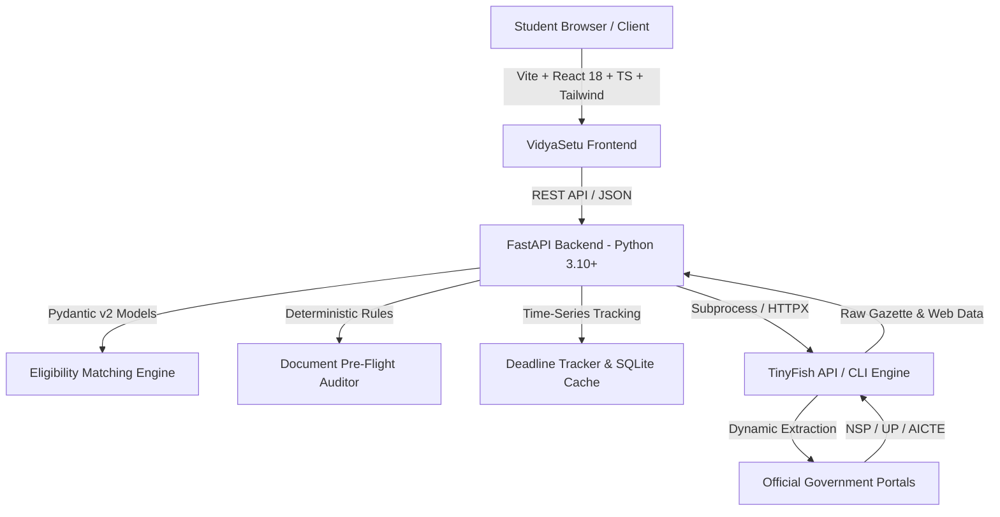

# VidyaSetu — Welfare Intelligence
## HackIIITD 2026 | Technical Implementation Plan

**Team Name:** TwoBit  
**Institute:** KIET Group of Institutions, Ghaziabad (Delhi-NCR)  
**Project Lead:** Shubham Kumar  
**Repository:** [https://github.com/shubham34970/VidyaSetu.git](https://github.com/shubham34970/VidyaSetu.git)  
**Primary Integration:** TinyFish API (Web Navigation, Search & Content Extraction)

---

## 1. Executive Summary & Problem Context

Higher education welfare schemes in India (central, state, and corporate CSR) represent over **₹4,200+ Crores in annual unspent budget allocations**. Eligible students—particularly first-generation scholars, rural students, and minority/reserved categories—fail to claim these entitlements due to three systemic bottlenecks:
1. **Fragmented Silos:** Over 30+ state and central portals (NSP, UP Scholarship Portal, MahaDBT, AICTE) with inconsistent structures, dead links, and shifting PDF gazette notifications.
2. **The 84% Technical Rejection Trap:** More than 84% of disqualified applications stem from minor procedural defects: stale income certificates (past validity), non-matching category certificates, or missed 72-hour rectification windows.
3. **Information Asymmetry:** Students discover schemes after official deadlines have closed or fail to navigate complex eligibility matrices.

**VidyaSetu** is an autonomous civic-tech intelligence platform providing real-time scholarship discovery, deterministic rule normalization, explainable student eligibility matching, pre-flight document compliance audits, and verified deadline tracking.

---

## 2. Target Priority Schemes (Day-1 Targets)

1. **Uttar Pradesh Post-Matric & Inter-State Scholarship:**
   - *Target Portal:* `scholarship.up.gov.in`
   - *Target Group:* Post-matric students (General, OBC, SC/ST, Minority) domiciled in UP.
   - *Key Constraints:* Annual family income caps (₹2.0L for General/OBC/Minority; ₹2.5L for SC/ST), fee reimbursement up to approved caps, strict annual certificate validity.

2. **National Scholarship Portal (NSP) Central Sector Schemes:**
   - *Target Portal:* `scholarships.gov.in`
   - *Target Group:* Top 20th percentile students in Class 12 pursuing regular higher education.
   - *Key Constraints:* Family income <= ₹4.5L/annum, >= 80th percentile in relevant board, mandatory Aadhaar-bank account seeding.

3. **AICTE Pragati Scholarship for Girls:**
   - *Target Portal:* `aicte-india.org` / `scholarships.gov.in`
   - *Target Group:* Female students admitted to 1st year degree/diploma technical courses in AICTE-approved institutions (up to 2 girls per family).
   - *Key Constraints:* Family income <= ₹8.0L/annum, ₹50,000/annum contingency grant.

---

## 3. System Architecture & Tech Stack

### Technology Matrix
- **Frontend:** React 18, Vite, TypeScript, Tailwind CSS, Lucide React icons.
- **Backend:** Python 3.10+ (Current runtime: Python 3.13.2), FastAPI, Uvicorn, Pydantic v2, HTTPX, Python-dotenv.
- **Data & Cache:** SQLite3 with structured caching layer and configurable TTL.
- **Welfare Intelligence Integration:** TinyFish CLI (v0.52.1) & TinyFish REST API for headless dynamic traversal, search, and page content extraction.
- **Testing:** Pytest (Backend API and logic units), Vitest / React Testing checks (Frontend).

---

## 4. Milestone Roadmap & Acceptance Criteria

### Milestone 0: Repository Audit & Planning (Current)
- Clone and audit `https://github.com/shubham34970/VidyaSetu.git`.
- Validate toolchain (Python 3.13, Node 24, TinyFish CLI 0.52.1).
- Deliver `docs/IMPLEMENTATION_PLAN.md` and `docs/DEVELOPMENT_LOG.md`.

### Milestone 1: Project Foundation
- Scaffold clean directory hierarchy: `frontend/`, `backend/`, `docs/`, `tests/`.
- Root and sub-project `.gitignore`, `.env.example`, and base `README.md`.
- FastAPI backend foundation with `/api/health` and CORS.
- Vite + React + TypeScript frontend scaffold with initial status page.
- Verification: Frontend builds cleanly, backend `/api/health` returns HTTP 200.

### Milestone 2: Professional Civic-Tech Frontend
- Design palette: Deep navy (`#0B192C`), slate indigo (`#1E3E62`), vibrant teal accents (`#008080` / `#00ADB5`), crisp off-white (`#F8FAFC`).
- Key UI Components:
  1. *Landing Page Hero* with civic impact stats and quick workflow preview.
  2. *Student Profile Intake Wizard* (State domicile, category, income, degree, marks, institution).
  3. *Main Dashboard* with personalized recommendation feed and status badges.
  4. *Scholarship Discovery Cards* with clear tags: Benefit amount, official source links, deadline status, verification badges (LIVE, CACHED, DEMO, UNVERIFIED).
  5. *Document Pre-Flight Auditor UI* (Certificate status checklist, expiry alerts, conflict diagnosis).
  6. *Deadline Tracker Board* with urgency countdowns and official circular timestamps.
- Verification: Responsive UI (mobile, tablet, desktop), production build check.

### Milestone 3: Modular FastAPI Backend
- Endpoints:
  - `GET /api/health`: Health status, runtime information, TinyFish status.
  - `GET /api/scholarships`: Paginated and filterable list of normalized schemes.
  - `GET /api/scholarships/{id}`: Detailed scheme specification with source attribution.
  - `POST /api/student/profile`: Validate and store session student profiles.
  - `POST /api/eligibility/match`: Match student profile against known schemes.
  - `POST /api/documents/audit`: Run pre-flight compliance check against required documents.
  - `GET /api/deadlines`: Query upcoming application closing dates and changes.
  - `POST /api/discovery/search`: Trigger live/cached scholarship discovery.
- Verification: Pytest suite validating input schemas, HTTP status codes, error models.

### Milestone 4: TinyFish Integration Engine
- Service module: `backend/services/tinyfish_service.py`.
- Support dual execution modes:
  1. Direct Subprocess invocation of installed `tinyfish` CLI (`tinyfish search query`, `tinyfish fetch content get`).
  2. Direct HTTP fallback to TinyFish REST API (`https://api.tinyfish.io/v1`).
- Robust fallback to verified offline cached schemes if `TINYFISH_API_KEY` is not configured or network fails.
- Safe secret management via `backend/.env` (strictly ignored by Git).
- Verification: CLI/API search test and graceful degradation test.

### Milestone 5: Structured Scholarship Normalization
- Schema definition in `backend/schemas/scholarship.py` using Pydantic v2.
- Attributes: `scheme_id`, `name`, `portal_name`, `source_url`, `domiciles`, `categories`, `min_percentage`, `max_family_income`, `benefit_description`, `benefit_amount_inr`, `application_deadline`, `verification_status`, `last_retrieved_at`.
- Strict truth-in-data: No simulated claims; unverified fields explicitly flagged as `UNKNOWN`.
- Verification: Schema validation unit tests on edge-case and malformed inputs.

### Milestone 6: Student Eligibility Matching Engine
- Core module: `backend/services/eligibility_service.py`.
- Multi-dimensional matching:
  - Domicile rule (State check).
  - Social category rule (General / OBC / SC / ST / EWS).
  - Income ceiling check (with boundary test cases).
  - Academic qualification & percentage score criteria.
  - Gender/Course-specific rules (e.g. AICTE Pragati female technical criteria).
- Match statuses: `ELIGIBLE`, `POTENTIALLY_ELIGIBLE`, `INELIGIBLE`, `INSUFFICIENT_INFORMATION`.
- Explainable outputs: List of satisfied rules, failed rules, and missing data points with source citations.
- Verification: Comprehensive unit test suite with 10+ edge cases.

### Milestone 7: Document Pre-Flight Compliance Auditor
- Core module: `backend/services/document_auditor.py`.
- Rules engine checking:
  - Domicile Certificate presence and validity.
  - Income Certificate issuance date vs scheme-specific financial year requirements (e.g., UP 3-year validity vs single financial year rules).
  - Caste/Category Certificate issuing authority validation.
  - Aadhaar-Bank Account NPCI seeding status reminder.
  - Fee receipt and bonafide student certificate requirements.
- Status output: `PASS`, `WARNING`, `FAIL`, `ACTION_REQUIRED`.
- Verification: Unit tests for date boundaries and document consistency.

### Milestone 8: Scholarship Deadline Tracker
- Core module: `backend/services/deadline_service.py`.
- Tracks: Scheme ID, Official portal deadline, Last verified timestamp, Change detection (e.g. extension circulars), Urgency level (`CRITICAL`, `UPCOMING`, `OPEN`, `EXPIRED`, `TENTATIVE`).
- Verification: Tests for date diff calculations and extension detection.

### Milestone 9: End-to-End Integration
- Bind React frontend to FastAPI backend using typed API client.
- End-to-end user journey verification:
  1. Intake profile -> Discover schemes -> Match eligibility -> Audit documents -> Track deadlines.
  2. Live vs Demo mode indicator toggle.
- Verification: End-to-end smoke test through UI interactions.

### Milestone 10: Security, QA & Production Hardening
- Complete audit for:
  - Zero committed secrets or `.env` files.
  - CORS security restricting to authorized local origins.
  - Robust Pydantic error validation without leaking stack traces.
  - TypeScript strict compilation with zero type errors.
  - Frontend production build (`npm run build`).
  - Pytest test suite passing 100%.

### Milestone 11: Release Documentation & Hackathon Pitch Pack
- Comprehensive `README.md` with Windows PowerShell & CMD quick-start.
- Architecture diagrams, API reference, TinyFish setup guide.
- Live demo walkthrough script for hackathon judges.
- Final update to `docs/DEVELOPMENT_LOG.md`.

---

## 5. Environment Variables & Configuration

| Variable | Scope | Description | Default / Example |
| :--- | :--- | :--- | :--- |
| `TINYFISH_API_KEY` | Backend | TinyFish API key for live searches | `""` (Degrades gracefully to cached data) |
| `BACKEND_PORT` | Backend | Port for FastAPI Uvicorn server | `8000` |
| `BACKEND_HOST` | Backend | Host bind address | `127.0.0.1` |
| `CACHE_TTL_SECONDS` | Backend | Time to live for cached portal queries | `86400` (24 Hours) |
| `CORS_ORIGINS` | Backend | Allowed CORS origins | `http://localhost:5173,http://127.0.0.1:5173` |
| `VITE_API_BASE_URL` | Frontend | Base URL of FastAPI backend | `http://127.0.0.1:8000/api` |
